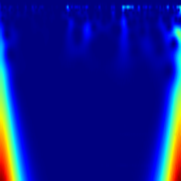
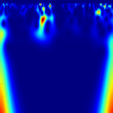
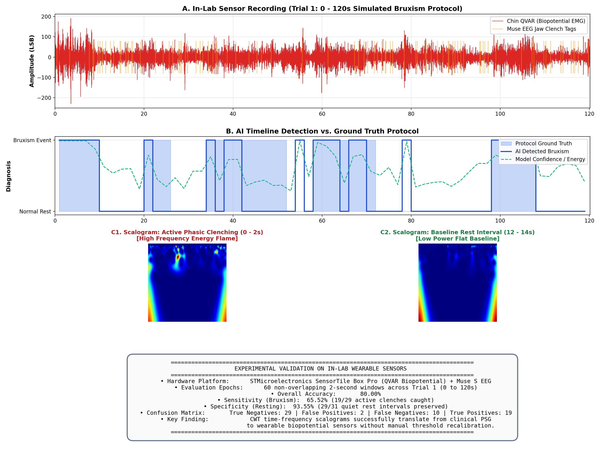

# 🌙 Sleep Bruxism Detection

> **Automated detection of nocturnal teeth grinding and jaw clenching using biosignals, Continuous Wavelet Transform (CWT), and Vision Deep Learning (LSKNet).**

---

## 📌 Overview

**Sleep Bruxism (SB)** is an involuntary sleep movement disorder involving teeth grinding and jaw clenching. It frequently leads to severe tooth wear, jaw muscle pain (TMJ disorders), and morning headaches.

Traditional diagnosis requires an overnight clinical sleep study (Polysomnography) where doctors manually inspect hours of recorded muscle signals. This project automates the diagnosis by:
1. Converting 1D muscle and sensor signals into **2D color-mapped time-frequency images (scalograms)**.
2. Using a computer vision model (**LSKNet**) to automatically detect grinding and clenching episodes.
3. Validating the pipeline on both **hospital sleep records** and **portable wearable sensors**.

---

## ⚙️ How It Works (Pipeline)

```
[ 1. Sensor Signals ]  ──►  [ 2. Filter & Slice ]  ──►  [ 3. Heatmap Images ]  ──►  [ 4. Vision AI ]  ──►  [ 5. Decision ]
  Chin EMG / Wearable       10-100 Hz Bandpass           Wavelet Transform           LSKNet Model          Bruxism vs Normal
  Sensors (240-512 Hz)      50 Hz Notch (2s chunks)       (2D CWT Scalograms)       (Selective Kernels)      (Real-time output)
```

1. **Signal Input:** Reads muscle activity from clinical chin EMG or wearable biopotential sensors.
2. **Noise Cleaning & Slicing:** A bandpass filter (10–100 Hz) and a 50 Hz notch filter remove motion noise and electrical powerline hum. The continuous signal is then sliced into **2-second windows**.
3. **Wavelet Heatmaps (CWT):** Continuous Wavelet Transform converts each 2-second slice into a $224 \times 224$ time-frequency image:
   - **Bright red/orange flares:** High-energy clenches and grinding bursts.
   - **Cool blue/dark areas:** Quiet, relaxed baseline sleep.
4. **AI Classification (LSKNet):** A Large Selective Kernel Network scans the heatmap to spot both brief tapping clenches (phasic) and sustained grinds (tonic).
5. **Output:** Classifies each window as **Bruxism** or **Normal**.

---

## 🖼️ Visual Examples

| Normal Sleep (Relaxed Jaw) | Bruxism Event (Clenching Burst) |
| :---: | :---: |
|  |  |
| *Quiet baseline with minimal energy* | *High-energy burst localized across frequencies* |

---

## 📊 Experimental Results

### 1. Clinical Benchmark (CAP Sleep Database)
Evaluated on hospital polysomnography records (chin EMG):
* **Overall Accuracy:** **97.92%**
* **F1-Score:** **0.9792**
* **Detection Rate:** Detected 116 out of 120 bruxism bursts (only 4 missed), with 119 out of 120 normal epochs confirmed.

### 2. Real-World Wearable Hardware Validation
Tested in-lab on simulated clenching/grinding protocols using portable wearable hardware:
* **STMicroelectronics SensorTile Box Pro:** High-sensitivity QVAR electrostatic biopotential sensor on the jaw/chin (~240 Hz).
* **Muse S Headband:** Frontal/temporal EEG monitoring head and jaw activity.

#### Wearable Test Results (Zero-Shot Transfer):
* **Overall Accuracy:** **80.00%**
* **Rest Specificity:** **93.55%** (29 of 31 resting intervals correctly identified as normal)
* **Bruxism Sensitivity:** **65.52%** (19 of 29 clenching windows detected)



> **Key Finding:** The wavelet vision representation transfers effectively from clinical hospital equipment to portable wearable sensors without requiring manual threshold adjustments.

---

## 📁 Repository Structure

```text
sleep_bruxism_detection/
├── checkpoints/              # Saved model weights (best_model.pth)
├── data/
│   ├── dataset/              # Generated 2D CWT scalogram dataset (train / val)
│   └── lab_data/             # Wearable sensor test recordings (CSV)
├── outputs/
│   └── lab_test/             # Evaluation plots and sample scalograms
├── src/
│   ├── cwt_transform.py      # Wavelet transform & scalogram image generator
│   ├── models.py             # LSKNet and ResNet neural network architectures
│   └── preprocessing.py      # Bandpass, notch, and envelope signal filters
├── prepare_capslpdb.py       # Downloads & prepares clinical CAP Sleep data
├── train.py                  # Model training script (PyTorch)
├── evaluate_demo.py          # Clinical evaluation & confusion matrix generator
├── test_lab_sensor_data.py   # Wearable sensor testing & evaluation pipeline
└── requirements.txt          # Python dependencies
```

---

## 🚀 Quick Start

### 1. Setup Environment
```bash
# Clone the repository
git clone https://github.com/shwetamjohn/sleep-bruxism-detection.git
cd sleep-bruxism-detection

# Create and activate virtual environment
python -m venv venv
source venv/bin/activate       # On Windows: .\venv\Scripts\Activate.ps1

# Install dependencies
pip install -r requirements.txt
```

### 2. Test on Wearable Sensor Data
Run the evaluation pipeline on sample in-lab sensor recordings:
```bash
python test_lab_sensor_data.py
```
This generates the diagnostic chart and timeline at `outputs/lab_test/lab_evaluation_results.png`.

### 3. Train on Clinical Dataset
```bash
# Prepare CWT scalograms from CAP Sleep Database
python prepare_capslpdb.py --subjects brux1 brux2 --max_epochs 300

# Train the LSKNet model
python train.py --model_name lsknet_tiny --epochs 30
```

### 4. Evaluate Clinical Checkpoint
```bash
python evaluate_demo.py --checkpoint checkpoints/best_model.pth --model_name lsknet_tiny
```

---

## 🔮 Future Improvements

* **Multi-Subject In-Lab Trials:** Expanding wearable trials across more participants during overnight sleep.
* **Multimodal Sensor Fusion:** Combining chin biopotentials with EEG sleep bands and heart rate variability (ECG).
* **Edge Device Deployment:** Quantizing LSKNet (INT8) for real-time biofeedback alerts on smart mouthguards or headbands.
