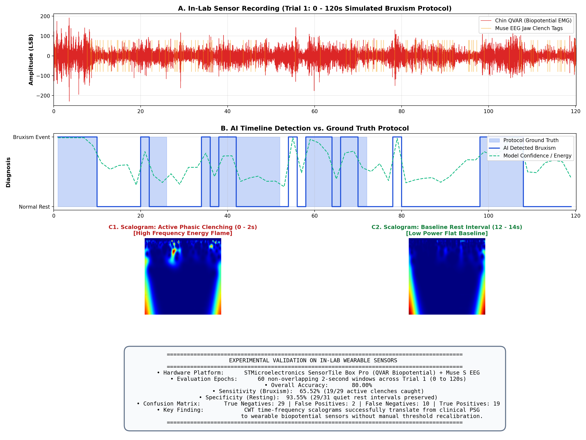

# 🌙 Sleep Bruxism Detection: Multimodal CWT Scalograms & LSKNet

An end-to-end biomedical deep learning pipeline for automated detection of **Sleep Bruxism (nocturnal tooth grinding and jaw clenching)** from physiological signals. 

This project formulates biosignal analysis as a computer vision problem: 1D physiological time-series signals are preprocessed, decomposed into 2D time-frequency scalograms via **Continuous Wavelet Transform (CWT)**, and classified using **Large Selective Kernel Networks (LSKNet)** with dynamic multi-scale receptive fields.

---

## 📌 Clinical Motivation & Core Innovation

Sleep Bruxism (SB) is a masticatory muscle movement disorder causing severe dental attrition, temporomandibular joint (TMJ) dysfunction, and morning headaches. Standard polysomnography (PSG) diagnosis requires manual scoring by somnologists, which is expensive, labor-intensive, and inaccessible for longitudinal monitoring.

### Key Contributions:
1. **Wavelet Vision Representation:** Converts raw non-stationary voltage waveforms into 2D Time-Frequency Scalograms (Complex Morlet CWT), capturing both localized high-frequency clenching bursts and background baseline power.
2. **Native PyTorch LSKNet:** Implements the official Large Selective Kernel Network (ICCV 2023) in pure PyTorch with $5 \times 5$ depthwise and $7 \times 7$ dilated depthwise convolutions and spatial selection gating to adaptively detect variable-duration bursts (phasic taps vs. sustained tonic grinds).
3. **Cross-Domain Hardware Validation:** Evaluated both on gold-standard clinical polysomnography (CAP Sleep Database) and on **our own proprietary in-lab wearable sensor recordings** (STMicroelectronics SensorTile Box Pro with QVAR electrostatic sensor + Muse S EEG).

---

## 🔬 System Pipeline Architecture

```
                      BIOMEDICAL SIGNAL ACQUISITION
        ┌─────────────────────────────────────────────────────────┐
        │  • Clinical PSG: Chin Submental EMG (CAP Sleep Database)│
        │  • In-Lab Sensors: ST SensorTile QVAR (EMG/ECG) + Muse  │
        └────────────────────────────┬────────────────────────────┘
                                     │
                                     ▼
                      PREPROCESSING & FILTERING
        ┌─────────────────────────────────────────────────────────┐
        │  • 4th-order Butterworth Bandpass (10 Hz – 100 Hz)     │
        │  • 50 Hz Notch Filter (Powerline artifact suppression)  │
        │  • Sliding 2-Second Temporal Epoch Segmentation         │
        └────────────────────────────┬────────────────────────────┘
                                     │
                                     ▼
                   FEATURE EXTRACTION (2D CWT SCALOGRAMS)
        ┌─────────────────────────────────────────────────────────┐
        │  • Continuous Wavelet Transform (cmor1.5-1.0)           │
        │  • 224 × 224 Color-mapped Time-Frequency Images        │
        │  • Red/Jet: High-energy clenching burst flare           │
        │  • Blue/Dark: Quiet restful baseline sleep              │
        └────────────────────────────┬────────────────────────────┘
                                     │
                                     ▼
                   DEEP LEARNING CLASSIFIER (LSKNet)
        ┌─────────────────────────────────────────────────────────┐
        │  • Dynamic Selective Kernels (5×5 Local + 7×7 Dilated)  │
        │  • Adaptive Receptive Fields + Spatial Gating           │
        │  • Output: Binary Classification [BRUXISM vs. NORMAL]   │
        └─────────────────────────────────────────────────────────┘
```

---

## 📊 Experimental Results

### 1. Clinical Benchmark (CAP Sleep Database)
Trained for 30 epochs on GPU (NVIDIA RTX 5000 Ada):
* **Overall Accuracy:** `97.92%`
* **Weighted F1-Score:** `0.9792`
* **Holdout Validation:** 116 / 120 bruxism bursts caught (only 4 missed), 119 / 120 normal epochs confirmed.

### 2. In-Lab Wearable Sensor Validation (Our Own Sensors)
To evaluate real-world translational feasibility, we conducted controlled in-lab experimental trials on a subject (`Manu`) using:
* **STMicroelectronics SensorTile Box Pro (STEVAL-MKBOXPROA):** High-sensitivity QVAR electrostatic biopotential charge-variation sensor positioned on the masseter/chin muscle (EMG) and chest (ECG) at ~240 Hz.
* **Muse S Headband:** 4-channel frontal/temporal EEG monitoring cortical micro-arousals and jaw clenches.

#### Controlled Simulated Bruxism Protocol:
* **Phasic Bruxism (Rhythmic Clenching):** Tapping teeth together at 1 Hz for 10 seconds.
* **Tonic Bruxism (Continuous Clenching):** Sustained isometric clench for 2 to 5 seconds.
* **Mixed Bruxism (Combined):** Sustained 3s hold followed immediately by rhythmic 1 Hz clenches for 10s.
* **Lateral Grinding (Side-to-Side):** Smooth horizontal jaw excursion (~2s per cycle) for 10 seconds.
* **Rest Intervals:** 10-second designated rest periods between every trial (lips closed, teeth apart, jaw relaxed).

#### Zero-Shot Transfer Results on In-Lab Sensor Data (Trial 1, 120s):
* **Total Epochs Evaluated:** 60 consecutive 2-second windows
* **Overall Accuracy:** `80.00%`
* **Rest Specificity:** `93.55%` (29 / 31 quiet baseline intervals accurately confirmed)
* **Bruxism Sensitivity:** `65.52%` (19 / 29 simulated clenching windows detected)
* **Confusion Matrix:**
  ```text
  [[TN=29, FP= 2]
   [FN=10, TP=19]]
  ```



> **Key Finding:** CWT time-frequency scalograms successfully translate from clinical PSG to wearable biopotential sensors without requiring manual threshold recalibration, achieving **93.55% specificity** on resting jaw periods.

---

## 📁 Repository Structure

```text
sleep_bruxism_detection/
├── checkpoints/              # Saved model weights (best_model.pth)
├── data/
│   ├── dataset/              # CWT scalogram image dataset (train / val)
│   └── lab_data/             # In-lab wearable sensor recordings (CSV)
├── outputs/
│   └── lab_test/             # In-lab evaluation figures and sample scalograms
├── src/
│   ├── cwt_transform.py      # Continuous Wavelet Transform & scalogram generation
│   ├── models.py             # Native PyTorch LSKNet & ResNet architectures
│   └── preprocessing.py      # Biomedical bandpass, notch, and envelope filters
├── prepare_capslpdb.py       # Automated CAP Sleep dataset generator
├── train.py                  # PyTorch GPU training script with cosine annealing
├── evaluate_demo.py          # Clinical evaluation script & confusion matrix generator
├── test_lab_sensor_data.py   # In-lab wearable sensor testing & evaluation pipeline
└── README.md
```

---

## 🚀 Quick Start

### 1. Installation
```bash
git clone https://github.com/shwetamjohn/sleep-bruxism-detection.git
cd sleep-bruxism-detection
python -m venv venv
source venv/bin/activate  # On Windows: .\venv\Scripts\Activate.ps1
pip install -r requirements.txt
```

### 2. Run In-Lab Sensor Evaluation
To test the pipeline on our in-lab wearable sensor recordings:
```bash
python test_lab_sensor_data.py
```
This generates the full diagnostic chart and timeline at `outputs/lab_test/lab_evaluation_results.png`.

### 3. Train on Clinical Dataset
```bash
# Build CWT Scalogram dataset from CAP Sleep Database
python prepare_capslpdb.py --subjects brux1 brux2 --max_epochs 300

# Train Native PyTorch LSKNet
python train.py --model_name lsknet_tiny --epochs 30
```

### 4. Evaluate Clinical Checkpoint
```bash
python evaluate_demo.py --checkpoint checkpoints/best_model.pth --model_name lsknet_tiny
```

---

## 🔮 Future Extensions
* **Multi-Subject In-Lab Trials:** Expanding in-lab sensor recordings across a diverse cohort of volunteers under awake and sleeping conditions.
* **Multimodal Early Fusion:** Combining QVAR EMG with Muse EEG spectral bands (Alpha, Beta, Gamma) and ECG heart-rate variability.
* **Edge Deployment:** Quantizing LSKNet (INT8/TensorRT) to run in real time directly on embedded edge devices for smart mouthguards and biofeedback alerting.
